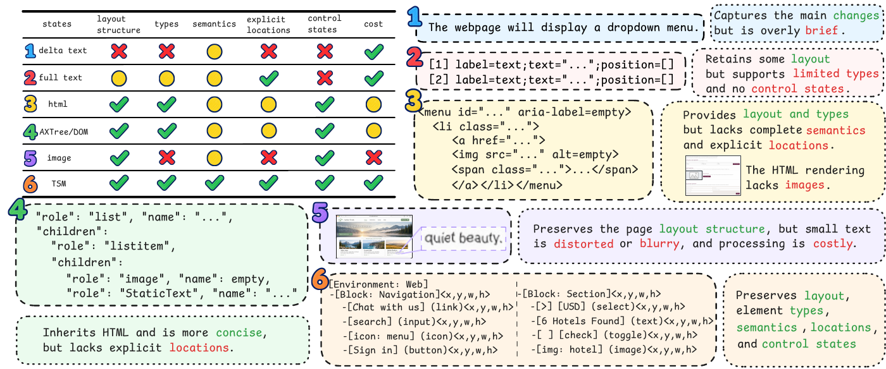
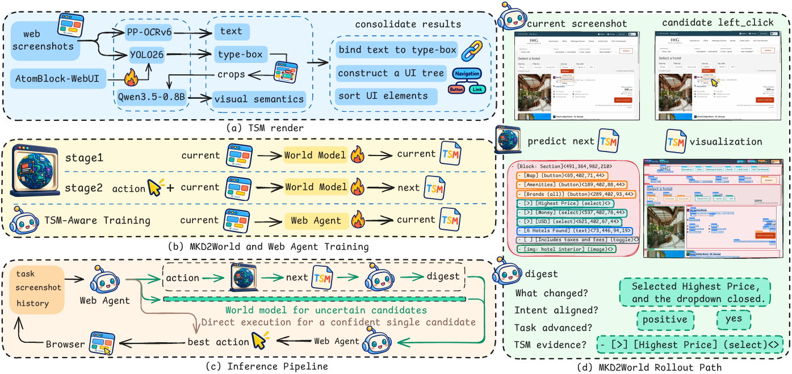

<h1 align="center"> MKD2WORLD: A Typed Spatial Markdown World Model for Web Agents</h1>

<p align="center">
  <a href="https://arxiv.org/abs/2611.06544"></a>
  <a href="https://huggingface.co/datasets/ZhihaoNan/AtomBlock-WebUI"></a>
  <a href="https://huggingface.co/ZhihaoNan/MKD2World-9B"></a>
</p>


We propose Typed Spatial Markdown (TSM), a structured and spatially grounded Web UI state representation that encodes UI semantics, explicit spatial information, control states, and hierarchical structures, together with a screenshot-to-TSM renderer.

MKD2World is a desktop web world model. From the current screenshot and a candidate action, it predicts the next interface as TSM. The repository implements that pipeline end to end. AtomBlock-WebUI builds the pages that supervise the detector. The screenshot-to-TSM renderer turns a page image into TSM. MKD2World learns the current page, then learns the action-conditioned next page. At decision time, the web agent proposes candidates, reads and interprets each predicted TSM, and selects the action. EleF1 scores a predicted TSM against the reference TSM. Online-Mind2Web (109 tasks) and VisualWebArena (233 tasks) score the web agent.


## Code Structure

| Path | Role |
| --- | --- |
| `atomblock/dataset/` | Build AtomBlock-WebUI: dedup, HTML generation, CC3M index, image injection, Playwright labels |
| `atomblock/read_yolo_boxes.py` | Read laid-out boxes from HTML whose classes already start with `yolo-` |
| `atomblock/train_yolo.sh` | Train YOLO26 on the exported detection set |
| `tsm_renderer/` | Screenshot-to-TSM builder, YOLO and OCR services, detector training |
| `mkd2world/training/` | Stage-1 SFT, stage-2 next-TSM loss, focus labels, 35B current-TSM trainer, EleF1 |
| `mkd2world/local_wm_runtime.py` | Turn one screenshot and one candidate action into the next TSM |
| `judges/` | Four-score annotation prompt, and the Online-Mind2Web trajectory judge |
| `agent/` | Index of the prompts above |
| `eval/` | Online-Mind2Web 109 and VisualWebArena 233 runners |
| `configs/` | Recorded Online-Mind2Web digest settings for the 9B and 35B agents |

`atomblock/dataset/` is the construction path:

| Script | Role |
| --- | --- |
| `dedup_screenshots.py` | Per-folder dHash, Hamming threshold 5, keep the largest file |
| `generate_html.py` | One process that calls the HTML generator |
| `run_generate_html.py` | Several processes over a screenshot directory |
| `download_cc3m.py` | Download `pixparse/cc3m-wds` |
| `extract_cc3m.py` | Unpack Arrow shards into `{shard}/{key}.jpg` and `.txt` |
| `build_caption_index.py` | MiniLM-L6-v2 embeddings and a 384-d inner-product FAISS index |
| `run_caption_index.py` | The same index on several GPUs, then one merged index |
| `render_pages.py` | Inject images, render 1920×1080 full-page screenshots, write YOLO labels |
| `prompts/html_generation.md` | The HTML prompt sent with each reference screenshot |

## Models the Entry Points Load

- UI detector: a YOLO26 checkpoint trained by `atomblock/train_yolo.sh`.
- OCR: PaddleOCR, started by `tsm_renderer/services/ocr_vl_service.py` (port 8002).
- Icon and image semantics: Qwen3.5-0.8B, at the URL passed to the renderer.
- World model: Qwen3.5-9B, then the stage-1 LoRA, then the stage-2 LoRA.
- Caption retrieval for AtomBlock-WebUI: `sentence-transformers/all-MiniLM-L6-v2`.
- EleF1: `paraphrase-multilingual-MiniLM-L12-v2`.
- Web agent: Qwen3.5-9B or Qwen3.5-35B-A3B on the OpenAI-compatible endpoint in `eval/`.
- HTML generation: `qwen3.6-plus` through `ATOMBLOCK_API_KEY` and `ATOMBLOCK_BASE_URL`.

## Prompts

| File | Role |
| --- | --- |
| `mkd2world/prompts/p2.1/candidate.md` | Propose candidate actions |
| `mkd2world/prompts/p2.1/digest.md` | Read one predicted TSM |
| `mkd2world/prompts/p2.1/best.md` | Choose the action |
| `mkd2world/prompts/p2.1/without_digest/` | Ablation without the digest step |
| `mkd2world/prompts/templatesV3/vanilla/gui_agent.md` | Bare agent prompt used by the VisualWebArena runner |
| `mkd2world/prompts/templatesV3/train_localwm/localwm_cur.md` | Stage-1 current TSM |
| `mkd2world/prompts/templatesV3/train_localwm/localwm_next.md` | Stage-2 and inference next TSM |

## Environments

The modules run in separate conda environments, because the detector, PaddleOCR, vLLM, and VisualWebArena pin different Python and torch versions. The perception services and model servers talk over HTTP, so each one stays in its own environment. The versions are those of the paper runs: Linux, NVIDIA A800, CUDA 13.0 wheels. `requirements.txt` is the union of these lists.

| Environment | Python | Runs | Main packages |
| --- | --- | --- | --- |
| `yolo` | 3.12 | `atomblock/train_yolo.sh`, YOLO service, `run_atomblock_to_markdown.py` | torch 2.12.1, ultralytics 8.4.84, fastapi, uvicorn |
| `gui_ocr_gpu` | 3.11 | OCR service | paddlepaddle-gpu 3.2.1, paddleocr 3.7.0, paddlex 3.7.2 |
| `qwen3.5` | 3.11 | Qwen3.5-0.8B service, stage-1 and stage-2 training, EleF1, Online-Mind2Web runner | vllm 0.24.0, torch 2.11.0, transformers 5.12.1, peft 0.19.1, accelerate 1.14.0, playwright 1.37.0 |
| `qwen3.5-fast` | 3.11 | 35B current-page trainer, `vllm serve` in `eval/*.sh` | `qwen3.5` plus flash-linear-attention 0.5.1, causal-conv1d 1.6.2 |
| `vwa_eval` | 3.10 | VisualWebArena runners | VisualWebArena `requirements.txt`: torch 2.0.1, transformers 4.34.0, playwright 1.37.0 |
| `atomblock` | 3.11 | `atomblock/dataset/` | faiss-cpu, sentence-transformers, playwright, beautifulsoup4, datasets, pyarrow, openai |

Place the environments under `envs/` in the repository root. The VisualWebArena runtime looks for `envs/visualwebarena`, `envs/ms-playwright`, and `envs/vwa_eval/lib` there.

```bash
export ENVS=$PWD/envs
export PLAYWRIGHT_BROWSERS_PATH=$ENVS/ms-playwright

conda create -y -p $ENVS/yolo python=3.12 pip
$ENVS/yolo/bin/pip install torch==2.12.1 torchvision==0.27.1 ultralytics==8.4.84 fastapi uvicorn requests

conda create -y -p $ENVS/gui_ocr_gpu python=3.11
$ENVS/gui_ocr_gpu/bin/pip install paddlepaddle-gpu==3.2.1 -i https://www.paddlepaddle.org.cn/packages/stable/cu130/
$ENVS/gui_ocr_gpu/bin/pip install paddleocr==3.7.0 paddlex==3.7.2

conda create -y -p $ENVS/qwen3.5 python=3.11
$ENVS/qwen3.5/bin/pip install vllm==0.24.0 transformers==5.12.1 peft==0.19.1 accelerate==1.14.0 \
  datasets pyarrow openai playwright==1.37.0
$ENVS/qwen3.5/bin/python -m playwright install chromium

conda create -y -p $ENVS/qwen3.5-fast --clone $ENVS/qwen3.5
$ENVS/qwen3.5-fast/bin/pip install flash-linear-attention==0.5.1
$ENVS/qwen3.5-fast/bin/pip install causal-conv1d==1.6.2.post1 --no-build-isolation

conda create -y -p $ENVS/vwa_eval python=3.10
conda install -y -p $ENVS/vwa_eval -c conda-forge \
  atk-1.0 at-spi2-atk at-spi2-core libcups libxkbcommon xorg-libxdamage libgbm alsa-lib
git clone https://github.com/web-arena-x/visualwebarena $ENVS/visualwebarena
$ENVS/vwa_eval/bin/pip install -r $ENVS/visualwebarena/requirements.txt
$ENVS/vwa_eval/bin/pip install -e $ENVS/visualwebarena

conda create -y -p $ENVS/atomblock python=3.11
$ENVS/atomblock/bin/pip install faiss-cpu sentence-transformers playwright beautifulsoup4 \
  pillow numpy pyarrow datasets openai tqdm
$ENVS/atomblock/bin/python -m playwright install chromium
```


The entry points take the interpreter from these variables:

| Entry point | Variables |
| --- | --- |
| `tsm_renderer/services/start_services.sh` | `PROJECT_ENVS_DIR=$ENVS`, or `YOLO_ENV`, `OCR_ENV`, `QWEN_ENV` for one service; `QWEN_MODEL=/path/to/Qwen3.5-0.8B` |
| `atomblock/train_yolo.sh` | `PYTHON_BIN=$ENVS/yolo/bin/python` |
| `eval/run_om2w_*.sh` | `MKD2WORLD_PYTHON=$ENVS/qwen3.5/bin/python`, `MKD2WORLD_VLLM=$ENVS/qwen3.5-fast/bin/vllm`, `MKD2WORLD_PLAYWRIGHT_BROWSERS=$ENVS/ms-playwright` |
| `eval/run_vwa_qwen35b_mkd2world_digest.sh` | `MKD2WORLD_PYTHON=$ENVS/vwa_eval/bin/python`, `MKD2WORLD_VLLM=$ENVS/qwen3.5-fast/bin/vllm`, `MKD2WORLD_VWA_ROOT=$ENVS/visualwebarena`, `MKD2WORLD_PLAYWRIGHT_BROWSERS=$ENVS/ms-playwright`, `MKD2WORLD_BROWSER_LIB=$ENVS/vwa_eval/lib` |

Run `mkd2world.training.sft`, `next_tsm_sft`, and `evaluation` with `$ENVS/qwen3.5/bin/python`, and `qwen35_35b_current_tsm_runtime` with `$ENVS/qwen3.5-fast/bin/python`. The Online-Mind2Web runner needs Python 3.11 for `enum.StrEnum`. The VisualWebArena runners add it on 3.10.

## Key Commands

### Build AtomBlock-WebUI


```bash
python atomblock/dataset/dedup_screenshots.py \
  --src /path/to/screenshots \
  --dst /path/to/screenshots_kept \
  --log /path/to/dedup_log.json
```

```bash
export ATOMBLOCK_API_KEY=...
export ATOMBLOCK_BASE_URL=https://your-openai-compatible-endpoint/v1
python atomblock/dataset/run_generate_html.py \
  --input-dir /path/to/screenshots_kept \
  --output-dir /path/to/AtomBlock-WebUI/html \
  --model qwen3.6-plus \
  --workers 4 \
  --concurrency 50
```

```bash
python atomblock/dataset/download_cc3m.py --cache-dir /path/to/cc3m-cache
python atomblock/dataset/extract_cc3m.py --src /path/to/arrow --out /path/to/cc3m
python atomblock/dataset/run_caption_index.py \
  --cc3m-dir /path/to/cc3m \
  --index-dir /path/to/caption_index \
  --ngpus 8
```

```bash
python atomblock/dataset/render_pages.py \
  --html-dir /path/to/AtomBlock-WebUI/html \
  --output-dir /path/to/AtomBlock-WebUI \
  --index-dir /path/to/caption_index \
  --workers 32
```


### Train the UI Detector

`atomblock/train_yolo.sh` calls `tsm_renderer/training/train_atomblock_yolo.py`. The recorded detector run uses image size 1920, seed 0, and batch 64.

```bash
python tsm_renderer/training/train_atomblock_yolo.py \
  --data /path/to/data.yaml \
  --model /path/to/yolo26m.pt \
  --project /path/to/yolo_output
```

### Render Screenshots to TSM

Start each perception service in its own process, then convert a directory of screenshots:

```bash
MD_RENDER_SERVICE=yolo YOLO_DEVICE=cuda:0 YOLO_PORT=8001 bash tsm_renderer/services/start_services.sh
MD_RENDER_SERVICE=ocr OCR_PORT=8002 bash tsm_renderer/services/start_services.sh
MD_RENDER_SERVICE=qwen QWEN_PORT=8000 bash tsm_renderer/services/start_services.sh
```

```bash
python tsm_renderer/run_atomblock_to_markdown.py \
  --image_dir /path/to/screenshots \
  --model /path/to/yolo26m.pt \
  --output /path/to/tsm \
  --use-vl \
  --yolo-url http://127.0.0.1:8001 \
  --ocr-url http://127.0.0.1:8002 \
  --qwen-url http://127.0.0.1:8000
```

### Train MKD2World

Stage 1 learns the current page. 

```bash
python -m torch.distributed.run --standalone --nproc_per_node=2 -m mkd2world.training.sft \
  --train-jsonl /path/to/current_tsm.jsonl \
  --output-dir /path/to/stage1 \
  --base-model /path/to/Qwen3.5-9B \
  --prompt-key localwm_cur \
  --per-device-train-batch-size 2 \
  --gradient-accumulation-steps 5 \
  --learning-rate 2e-5 \
  --lr-scheduler-type cosine \
  --warmup-ratio 0.03 \
  --weight-decay 0.01 \
  --seed 0 \
  --num-train-epochs 1 \
  --save-steps 150 \
  --lora-r 32 \
  --lora-alpha 64 \
  --lora-dropout 0.05 \
  --target-modules qwen35_expanded \
  --max-length 20000 \
  --max-output-tokens 6000 \
  --device-mode ddp
```

Stage 2 continues that adapter and learns the next page. 

```bash
python -m mkd2world.training.next_tsm_sft train --manifest /path/to/stage2_manifest.json
```

The 35B current-page trainer uses `localwm_cur` as well:

```bash
python -m mkd2world.training.qwen35_35b_current_tsm_runtime train --manifest /path/to/agent_manifest.json
```

### Score Predicted TSM

```bash
python -m mkd2world.training.evaluation \
  --predictions-jsonl /path/to/predictions.jsonl \
  --output /path/to/scores.json
```

### Online Evaluation


```bash
export MKD2WORLD_AGENT_BASE=/path/to/Qwen3.5-9B
export MKD2WORLD_WM_BASE=/path/to/Qwen3.5-9B
export MKD2WORLD_WM_ADAPTER=/path/to/mkd2world
export MKD2WORLD_OUTPUT_DIR=/path/to/run-output
bash eval/run_om2w_qwen9b_mkd2world_digest.sh
```


Online-Mind2Web task success, once a run has written trajectories:

```bash
python judges/trajectory_judge.py \
  --trajectories-dir /path/to/attempts \
  --output-dir /path/to/judge
```

